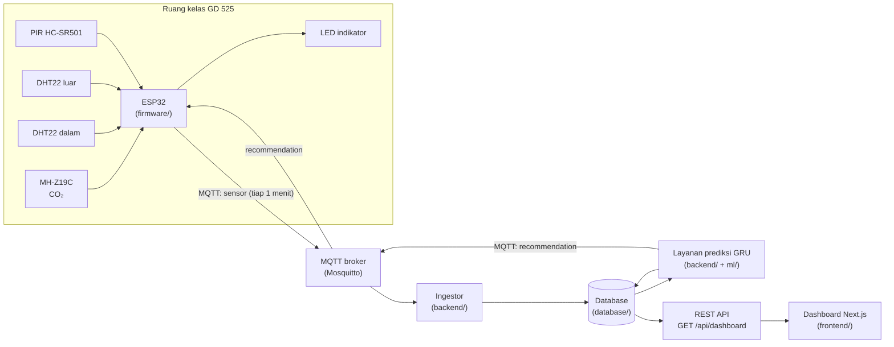

# 01. Arsitektur Sistem

## Tujuan sistem

Mengukur CO₂ dan kondisi ruang di satu ruang kelas berventilasi alami (lokasi utama: GD 525), memprediksi CO₂ 15 menit ke depan, lalu memberi **rekomendasi** ventilasi (flush 3 sampai 5 menit) lewat dashboard web dan LED indikator. Sistem tidak mengontrol jendela atau perangkat apa pun secara otomatis.

## Diagram alur data

## Komponen dan tanggung jawab

| Folder | Tanggung jawab | Bergantung pada |
|---|---|---|
| `firmware/` | Membaca sensor, merata-ratakan per menit, mengirim ke MQTT, menerima rekomendasi dan menyalakan LED | Kontrak data (bagian MQTT) |
| `backend/` | Menerima pesan MQTT, validasi, simpan ke database, menjalankan prediksi, menghitung rekomendasi, menyediakan REST API | Kontrak data, skema database, model dari `ml/` |
| `database/` | Skema tabel dan skrip inisialisasi | Kontrak data |
| `ml/` | Eksplorasi data, pelatihan GRU/LSTM/persistence, evaluasi (MAE, RMSE, R², lead time, alarm palsu), ekspor model | Data dari protokol pengambilan data |
| `frontend/` | Dashboard: CO₂ sekarang, prediksi, rekomendasi, riwayat, kejadian | Kontrak data (bagian REST API) |
| `docs/` | Dokumen ini | |

## Perilaku saat ada gangguan

| Kondisi | Perilaku yang diharapkan |
|---|---|
| ESP32 kehilangan Wi-Fi atau broker | Simpan pembacaan di memori sementara (batas wajar), kirim ulang saat tersambung. LED beralih ke mode lokal berbasis ambang CO₂ saat ini |
| Rekomendasi dari backend tidak datang lebih dari 5 menit | ESP32 memakai aturan lokal: CO₂ saat ini kurang dari 800 hijau, 800 sampai kurang dari 1000 kuning, 1000 atau lebih merah |
| Pesan sensor tidak masuk lebih dari 3 menit | Dashboard menampilkan status "Terputus" dan tidak menampilkan angka lama sebagai angka terkini |
| Model GRU belum tersedia atau gagal | Backend memakai prediksi persistence (nilai terakhir) dan menandainya di field `model` pada tabel prediksi |
| Sensor tertentu gagal dibaca | Nilainya dikirim `null` dan nama sensornya ditulis di `faults`. Pembacaan lain tetap disimpan |

## Batasan lingkup

- Satu ruang kelas, satu node ESP32.
- Rekomendasi bersifat saran; tidak ada aktuator.
- Status jendela dan pintu tidak diukur sensor. Kejadian pembukaan jendela hanya dicatat manual untuk membantu analisis (lihat dokumen 03).
- PIR hanya mendeteksi gerakan, bukan jumlah orang.
